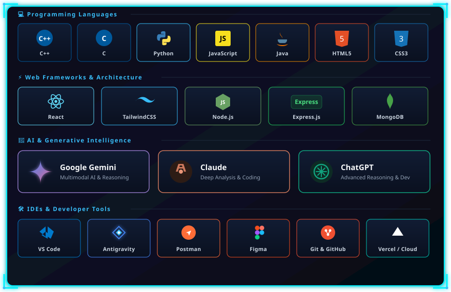
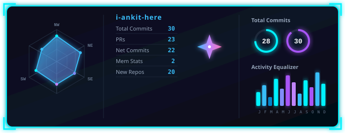

<!-- ==================== CYBERPUNK HEADER BANNER ==================== -->

  

 

<!-- ==================== CONNECT & QUICK LINKS ==================== -->

  
  
  
  
  

 

---

## About Me

> **Software Engineer** specializing in systems programming, data structures & algorithms, and AI-accelerated web architecture. Currently pursuing **B.Tech CSE ('27)** at **Dr. B. R. Ambedkar National Institute of Technology, Jalandhar**.

- **Engineering Focus:** Writing clean, scalable code in C++, architecting backend services, and solving complex algorithmic challenges.
- **AI Integration:** Leveraging frontier LLMs (**Gemini, Claude, GPT**) for rapid system prototyping, code synthesis, and intelligent RAG workflows.
- **Core Toolkit:** C++, Python, JavaScript, React, Node.js, MongoDB, alongside modern IDE environments (**VS Code** & **Antigravity**).
- **Ask Me About:** C++ optimization, DSA strategies, full-stack application structure, and LLM orchestration.

---

## Tech Stack

  

 

---

## 🐍 GitHub Contribution Activity

  <!-- Live Dynamic Contribution Snake (Powered by Platane/snk) -->
  <picture>
    <source media="(prefers-color-scheme: dark)" srcset="https://raw.githubusercontent.com/i-ankit-here/i-ankit-here/output/github-contribution-grid-snake-dark.svg">
    <source media="(prefers-color-scheme: light)" srcset="https://raw.githubusercontent.com/i-ankit-here/i-ankit-here/output/github-contribution-grid-snake.svg">
    
  </picture>

 

---

## 📊 GitHub Analytics & Activity

  
  
    

  <table align="center" border="0" cellpadding="0" cellspacing="0">
    <tr>
      <td>
        
      </td>
      <td>
        
      </td>
    </tr>
  </table>

 

---

## 🚀 Featured Engineering Projects

<table align="center" width="100%">
  <tr>
    <td width="50%" valign="top">
      <h4 align="center">🛡️ InsureRAG</h4>
      

        
        
      

      
Intelligent Retrieval-Augmented Generation (RAG) system engineered for high-accuracy insurance knowledge extraction, querying, and claims understanding.

      

        <a href="https://github.com/i-ankit-here/InsureRAG"><b>Explore Repository ➔</b></a>
      

    </td>
    <td width="50%" valign="top">
      <h4 align="center">✅ IHaveToDo</h4>
      

        
        
      

      
Clean, modern, and reactive task management application built for personal productivity and seamless task tracking.

      

        <a href="https://github.com/i-ankit-here/IHaveToDo"><b>Code</b></a> • 
        <a href="https://i-have-to-do.vercel.app" target="_blank"><b>Live Demo 🚀</b></a>
      

    </td>
  </tr>
  <tr>
    <td width="50%" valign="top">
      <h4 align="center">📅 AMS with TimeTable</h4>
      

        
        
      

      
Automated Attendance Management System paired with dynamic timetable scheduling to optimize academic schedules and attendance monitoring.

      

        <a href="https://github.com/i-ankit-here/AMS-with-TimeTable"><b>Explore Repository ➔</b></a>
      

    </td>
    <td width="50%" valign="top">
      <h4 align="center">🌐 Conference Website</h4>
      

        
        
      

      
Comprehensive conference portal supporting paper submissions, speaker lineups, schedule dissemination, and attendee registrations.

      

        <a href="https://github.com/i-ankit-here/Conference-website"><b>Explore Repository ➔</b></a>
      

    </td>
  </tr>
</table>

 

  

