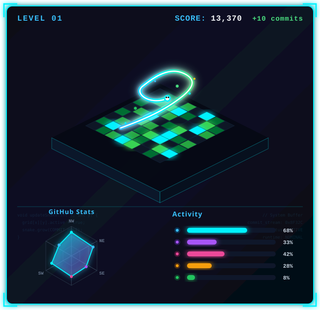

<!-- ==================== CYBERPUNK HEADER BANNER ==================== -->

  

 

<!-- ==================== MAIN CYBER HUD DASHBOARD ==================== -->
<table width="100%" border="0" cellspacing="12" cellpadding="0" align="center">
  <tr valign="top">
    <!-- LEFT COLUMN: 3D ISOMETRIC CONTRIBUTION SNAKE GAME -->
    <td width="48%" align="left">
      <h3>🐍 GitHub Contribution Snake Game</h3>
      
    </td>

    <!-- RIGHT COLUMN: TECH STACK & GITHUB STATS HUDS -->
    <td width="52%" align="left">
      <h3>💻 Tech Stack</h3>
      
      
       
      
      <h3>📊 GitHub Stats</h3>
      
    </td>
  </tr>
</table>

 

<!-- ==================== CONNECT & QUICK LINKS ==================== -->

  
  
  
  
  

 

---

### 🚀 Featured Projects

<table align="center" width="100%">
  <tr>
    <td width="50%" valign="top">
      <h4 align="center">🛡️ InsureRAG</h4>
      

        
        
      

      
Intelligent Retrieval-Augmented Generation (RAG) system engineered for high-accuracy insurance knowledge extraction, querying, and claims understanding.

      

        <a href="https://github.com/i-ankit-here/InsureRAG"><b>Explore Repository ➔</b></a>
      

    </td>
    <td width="50%" valign="top">
      <h4 align="center">✅ IHaveToDo</h4>
      

        
        
      

      
Clean, modern, and reactive task management application built for personal productivity and seamless task tracking.

      

        <a href="https://github.com/i-ankit-here/IHaveToDo"><b>Code</b></a> • 
        <a href="https://i-have-to-do.vercel.app" target="_blank"><b>Live Demo 🚀</b></a>
      

    </td>
  </tr>
  <tr>
    <td width="50%" valign="top">
      <h4 align="center">📅 AMS with TimeTable</h4>
      

        
        
      

      
Automated Attendance Management System paired with dynamic timetable scheduling to optimize academic schedules and attendance monitoring.

      

        <a href="https://github.com/i-ankit-here/AMS-with-TimeTable"><b>Explore Repository ➔</b></a>
      

    </td>
    <td width="50%" valign="top">
      <h4 align="center">🌐 Conference Website</h4>
      

        
        
      

      
Comprehensive conference portal supporting paper submissions, speaker lineups, schedule dissemination, and attendee registrations.

      

        <a href="https://github.com/i-ankit-here/Conference-website"><b>Explore Repository ➔</b></a>
      

    </td>
  </tr>
</table>

 

  

